# Arcane Visions — Spell Effect Animations

**Standalone post-cast spell animations for BGEE, BG2EE and EET.**

Arcane Visions gives selected original BG spells the visual effects used by
Spell Revisions or Icewind Dale: Enhanced Edition. It replaces the artwork
shown after a spell is cast, while retaining the installed spell's mechanics.
**Spell Revisions and IWDification are not required.**

Current version: **v0.2.0-beta.11**, by **Sauler89**.
 · [Affected spells](#affected-spells) 

## Animation examples

These GIFs are decoded from BAMs actually shipped with this mod. They are
illustrative previews, not screenshots captured in the game. Blend rendering
is approximated on a dark background; the engine controls placement, palette,
orientation and timing. Entangle shows an individual animated tendril.

| Shared protection aura — `SPMAGGLO` | Entangle — `SPENTAAI` | Ghost Armor — `GHARMOR` |
|:---:|:---:|:---:|
| 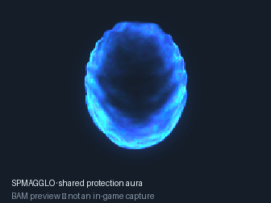 | 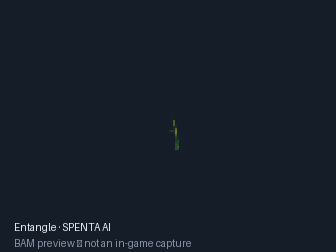 | 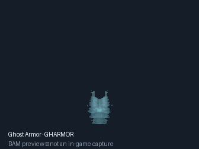 |

| Chromatic Orb — `SPCHRORB` | Mantle — `DVMANTLE` | Blade Barrier — `BBARRH1` |
|:---:|:---:|:---:|
| 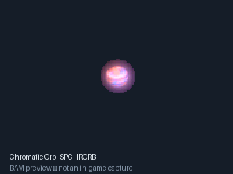 | 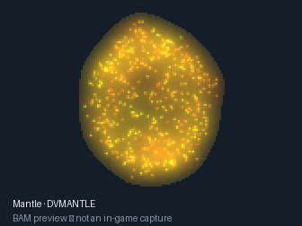 | 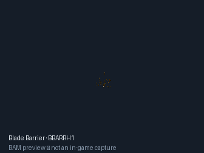 |

| Sanctuary — `SANCTRY` | Protection from Arrows — `PFNMISC` |
|:---:|:---:|
| 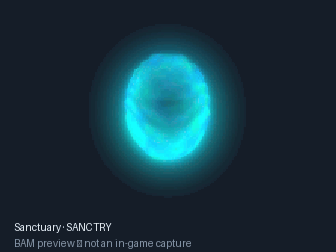 | 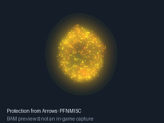 |

| Minor Globe of Invulnerability — `MGOINVC` | Globe of Invulnerability — `GOINVUC` |
|:---:|:---:|
| 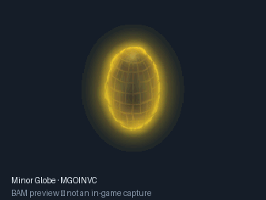 | 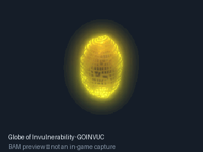 |

| Glitterdust — `GLDUSTA`, VVC phase 2 |
|:---:|
| 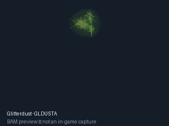 |

| Otiluke's Resilient Sphere — `ORSPHEC` | Resurrection — `RESURRH` |
|:---:|:---:|
| 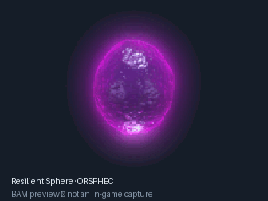 | 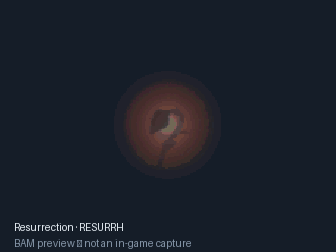 |

| Sol's Searing Orb — `SSORBT` travel | Call Lightning — `CALLLIH` |
|:---:|:---:|
| 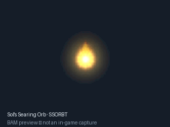 | 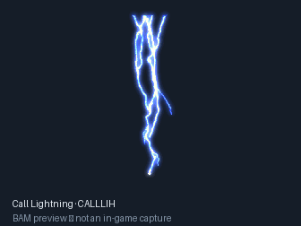 |

| Conjure Fire Elemental — `dvelfire` | Conjure Air Elemental — `dvelair` | Conjure Earth Elemental — `dveleart` |
|:---:|:---:|:---:|
| 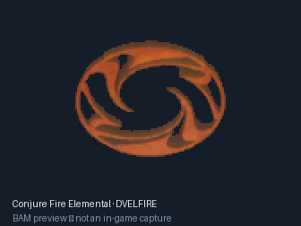 | 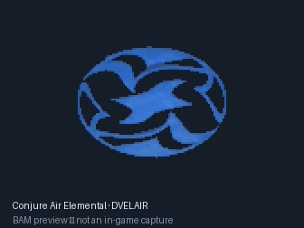 | 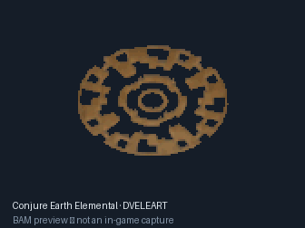 |

These three **Spell Revisions summoning effects** are also used by the
corresponding Conjure Lesser Elemental spells. They show the summoning animation;
the elemental creatures keep their installed appearance.

The two globe previews are **IWDEE effect animations**, added in beta.3.
The similarly named SR files `spwi406a/b/c` and `spwi602a/b/c` remain excluded
because they are icons. `SPMAGGLO` is a separate shared protection overlay.

## Components

| Component | Content | Assets |
|---|---|---|
| **0** | SR effect animations for selected original spells | 14 BAMs, 12 VVCs |
| **10** | IWDEE effects: 28 SPL resources, two temporary weapons and native lightning | 28 BAMs, 26 VVCs |

Components can be installed independently or together. Their targeted spell
lists are disjoint. The complete package contains **42 animation BAMs and
38 visual-controller VVCs**, and patches **44 SPL files (including two child spells)** in the
supplied EET baseline, plus the hit cues in **two temporary-weapon ITMs**. Additional spells use the replaced native graphics.

No spellbook/action-bar/portrait icons, new spells, revised spell descriptions,
IWDEE or SR gameplay, source SPL/EFF/PRO files, creature avatars or weapons
are imported. Existing casting-feature effects, sounds, damage, saves,
protections, summon mechanics and spell levels are retained. SORB alone uses
a newly registered clone of its installed projectile for isolated travel art.

## Installation

1. Extract the entire package into the BGEE/BG2EE/EET game folder containing `chitin.key`.
2. Run `setup-sr_original_spell_animations.exe` and select English or Italiano.
3. Install component **0**, **10**, or both. No source-game exports are needed.

Install after other mods that change these spells. On EET, also install after
**EET_end**. BGEE with or without Siege of Dragonspear is accepted.
Windows WeiDU 251 is bundled. On Linux/macOS, use a native WeiDU executable:

```sh
weidu sr_original_spell_animations/setup-sr_original_spell_animations.tp2
```

Uninstall or reinstall through the same installer. The existing installer,
folder names and component numbers are retained for compatibility with the
previous beta. BGEE (with or without SoD), BG2EE and EET are accepted. IWDEE,
PSTEE and classic BG1/BG2 are rejected before any assets are copied.
Only existing spell resources are patched: this mod does not add BG2 spells
to BGEE or make higher-level spells available. Component 10 skips unrecognized
installed visuals and missing child-spell, temporary-weapon or projectile routes.

## Affected spells

### Component 0 — Spell Revisions artwork

| Original spell / effect | SPL | SR animation BAM |
|---|---|---|
| Entangle | `SPPR105` | `spentaai, spentaci` |
| Chromatic Orb | `SPWI118` | `spchrorb` |
| Invisibility | `SPWI206` | `illush` |
| Mirror Image | `SPWI212` | `illush` |
| Invisibility 10′ Radius | `SPWI307` | `illush` |
| Pixie Dust | `SPPR516` | `illush` |
| Ghost Armor | `SPWI317` | `gharmor` |
| Spirit Armor | `SPWI414` | `sparmor` |
| Shadow Door | `SPWI505` | `dvsdoor` |
| Implosion | `SPPR728` | `dvimplo` |
| False Dawn | `SPPR609` | `dvsun` |
| Conjure Lesser Fire Elemental | `SPWI516` | `dvelfire` |
| Conjure Lesser Air Elemental | `SPWI520` | `dvelair` |
| Conjure Lesser Earth Elemental | `SPWI521` | `dveleart` |
| Conjure Fire Elemental | `SPWI620` | `dvelfire` |
| Conjure Air Elemental | `SPWI621` | `dvelair` |
| Conjure Earth Elemental | `SPWI622` | `dveleart` |
| Mantle (SR: Prismatic Mantle) | `SPWI708` | `dvmantle` |
| Shared deflection / immunity / shield overlay | `SPWI318, SPWI618, SPWI519, SPWI510 and its school subspells; SPPR701` | `spmagglo` |


For elemental spells, only the arrival animation at the chosen point changes.
Counts, creatures, summon EFFs and spawn timing are retained. Mantle uses SR's
Prismatic Mantle artwork without its new gameplay. False Dawn uses two visual
phases without importing SR's damage, blindness, confusion or subspells.

**Shared-resource scope:** `SPMAGGLO` is a native engine overlay. Replacing it
also changes spells/items from other mods that use that same resource, when
their current effects enable the overlay. This is not limited to the listed
five protection spells. Entangle and Chromatic Orb also retain their native
resource names; other consumers of those BAMs receive the replacement art.

### Component 10 — IWDEE artwork

The table lists the BAMs actually installed for the selected visual phases.
It does not list every animation used by each spell; other phases keep their
installed graphics.

| Original BG spell / phase changed | SPL | IWDEE animation BAM installed |
|---|---|---|
| Remove Paralysis | `SPPR308` | `RPARALH` |
| Poison | `SPPR411` | `POISONH` |
| Lesser Restoration | `SPPR417` | `LRESTORH` |
| Cure Critical Wounds | `SPPR502` | `CCWOUNH` |
| Blade Barrier | `SPPR603` | `BBARRH1`, `BBARRH2` |
| Finger of Death | `SPPR708` | `FODEATH` |
| Regeneration — initial cue | `SPPR711` | `REGENERH` |
| Greater Restoration | `SPPR713` | `GRESTORH` |
| Storm of Vengeance — direct target cue | `SPPR722` | `FODEATH` |
| Death Spell — target cue | `SPWI605` | `DSPELLH` |
| Power Word Silence | `SPWI612` | `PWSILEH` |
| Sphere of Chaos — selected direct cue | `SPWI711` | `CONFUSH` |
| Finger of Death | `SPWI713` | `FODEATH` |
| Power Word Stun | `SPWI715` | `PWSTUNH` |
| Dragon's Breath | `SPWI922` | `SPDRGNBR` |
| Sanctuary | `SPPR109` | `SANCTRY` |
| Protection from Normal Missiles / Arrows | `SPWI311` | `PFNMISC` |
| Minor Globe of Invulnerability | `SPWI406` | `MGOINVC` |
| Globe of Invulnerability | `SPWI602` | `GOINVUC` |
| Glitterdust — target cue | `SPWI224` | `GLDUSTA` |
| Otiluke's Resilient Sphere | `SPWI413` → `SPWI413A` | `ORSPHEC` |
| Resurrection | `SPPR712` → `SPPR712A` | `RESURRH` |
| Heal | `SPPR607` | `HEALH` |
| Slow Poison | `SPPR212` | `SPOISOH` |
| Miscast Magic | `SPPR310` | `MMAGICH` |
| Confusion (cleric) | `SPPR709` | `CONFUSH` |
| Confusion (wizard) | `SPWI401` | `CONFUSH` |
| Chaos | `SPWI508` | `CONFUSH` |
| Slay Living (weapon hit) | `SPPR511` → `SLAYLIVE.ITM` | `SLIVINH` |
| Sol's Searing Orb (weapon hit and travel) | `SPPR614` → `SORB.ITM` | `SSORBH`, `SSORBT` |
| Call Lightning (shared native graphics) | `SPPR302`; `SKYBOLT.BAM` | `CALLLIH` (alias of IWDEE `SKYBOLT`) |


Storm of Vengeance really shares the `FODEATH` target artwork with Finger of
Death in the supplied IWDEE files: `SPPR722.SPL` contains opcode 215 pointing
to `FODEATH.VVC`, whose main BAM is `FODEATH`. In the EET export the matching
cue points to `SPFINGER.VVC`/`SPFDEATH.BAM`; only that cue is redirected.
The storm projectile `STRMVENG.PRO` uses `SPSTRMVA.BAM`, which is byte-identical
in the supplied IWDEE and EET exports, so no redundant replacement is shipped.
Weather, area, projectiles and damage retain their installed behavior.
Sphere of Chaos replaces its
direct hit cue. The separate Confusion/Chaos spells now use the same IWDEE
artwork for their recognized status visuals; their mechanical confusion state
and visual effect timing/duration are retained. Blade
Barrier preserves the existing duration of both visual layers. Dito/Finger of
Death variants and Storm of Vengeance share one isolated `FODEATH` copy.

The four state overlays retain their existing state opcodes, duration,
conditions and protections. Only the recognized graphic reference/mode changes.
Both globes use private resources, so minor and major can show different art
without replacing `MINORGLB` globally. Sanctuary's state is retained; it is
never replaced with a graphics-only effect.

## Compatibility and graphics handling

The installer edits the resources currently present in the game. Missing
spells or unsupported/truncated/shared effect layouts are skipped. Component
10 additionally requires the recognized original visual reference, target,
attachment and effect count in each ability; unfamiliar visuals from another
mod are skipped and logged. Component 0 deliberately replaces all 141/215
ability visuals of its selected spells, while retaining their nonvisual effects.

Private resource names and the SRIOSORB symbol in both PROJECTL.IDS and
MISSILE.IDS are checked before installation. A collision aborts
that component before it can overwrite another mod's similarly named resource.
Native replacements intentionally overwrite the engine graphic resources.

Non-looping cues play their full sequence. Mantle follows the duration and
conditions of the existing weapon protection; False Dawn retains its two-phase
schedule. Elemental arrival cues are independent point effects, not changes to
opcode 67's resource fields. The IWD component preserves effect order/counts,
all nonvisual bytes and the probability/save/resistance/target conditions of
the replaced visual effects.

The complete source review compares **249 IWDEE BAMs, 388 exported EET BAMs,
and all 224 BAMs in the SR archive**. Only exact graphics and all-visible-cycle
art matches are duplicate evidence; partial matches and shared/recolored shapes
are diagnostics. Heal and Slow Poison are retained despite shared EET shapes.
All 28 imported IWD BAMs have no full-art match to the selected original-spell
SR artwork. One additional source BAM, SKYBOLT, is an alias of shipped CALLLIH.
The comparison concerns the supplied exports, not every modlist.

**This is a selected import, not all IWDEE BAMs.** Beta.4 adds Glitterdust,
Otiluke's Resilient Sphere, Resurrection, Heal and Slow
Poison. Beta.5 also adds Miscast Magic and binds the already included
CONFUSH artwork to both Confusion spells and Chaos. Chaos retains both
visual effect instances and their separate conditions; the existing effect
timing/duration remains unchanged for these three CONFUSH bindings. The source
controller is non-looping. Child spells are patched only
when the original root still calls them. The root bytes are unchanged.
The full archive review found no additional demonstrated active original-spell
SR artwork to add. **38 distinct IWD candidates remain unintegrated**, including
projectile/area/conditional phases; they are not labeled SR duplicates.
Included BAMs are also checked for uncovered spell bindings: the extra delayed
HEALH phase in IWD Regeneration has no matching direct cue in this EET baseline
and remains unbound. The initial REGENERH cue is included.
The review also found two unbound GLDUSTA area phases (spread/ring) in IWD
Glitterdust: its target cue is included, while the installed EET shared
projectile has different bindings. These are additional phases of already
included artwork, not two new BAMs.

**Web is excluded at the owner's request in beta.6**, including area and target
artwork. No Web SPL or PRO is patched and no private Web asset is shipped.
WEBA/WEBC/WEBX are classified as user exclusions in the source inventory,
separately from the 38 pending candidates.
**Abi-Dalzim's Horrid Wilting is also excluded in beta.7**: SPWI812 retains
its installed BG2EE/EET visual cue. ADHWILH and its private controller are
removed; ADHWILA/ADHWILX area phases are excluded from future candidates too.
Beta.8 adds the actual SLIVINH/SSORBH weapon impacts. Beta.9 also adds
SSORBT travel through a private clone of the installed EET projectile: only
SORB's projectile reference changes; speed/audio/gameplay remain installed.
Call Lightning replaces the shared native SKYBOLT BAM with CALLLIH IWDEE
(23 versus 6 EET frames), while preserving all SPL/PRO bytes and chain indexes.
Other SKYBOLT consumers receive the same art. CALLLIH and the previously
supplied IWDEE SKYBOLT are identical: only one is shipped. SPCALLLI remains
an EET duplicate. Chain rendering still needs an in-game test.
See [the projectile import review](sr_original_spell_animations/docs/PROJECTILE_IMPORT.it.md).
See [the full source review](sr_original_spell_animations/docs/FULL_SOURCE_AUDIT.it.md),
[all IWD decisions](sr_original_spell_animations/docs/iwd_selection_recheck.csv),
[all SR decisions](sr_original_spell_animations/docs/sr_source_selection.csv)
and [every pending candidate](sr_original_spell_animations/docs/iwd_pending_candidates.csv).

## Validation and beta status

WeiDU installation, reinstallation and byte-exact uninstallation passed in
isolated fixtures, including the **44 real exported EET SPL files and two ITMs**. Assets were
checked for hashes, frame bounds/RLE data, cycle references, VVC dependencies,
phase indexes, private names and absence of external palettes/alpha BAMs/audio.

An additional **28 regression cases** cover malformed layouts, an unused global
index, conditional visual effects, wrong targets/delays, resource collisions
and unsupported games. Source SR spell layouts and EET/BG2EE/BGEE synthetic
profiles also passed. **44 further overlay cases** verify state and conditional
duration preservation, recognized/custom layouts, safe skips and collisions.
**12 child-spell cases** verify recognized, missing, detached, malformed and
repurposed roots, unknown child visuals, reinstall and exact uninstall.
Full details and retained results are in
[the rigorous audit](sr_original_spell_animations/docs/RIGOROUS_AUDIT.md).

**The mod has not yet been visually tested in a launched BGEE, BG2EE or EET game.** Position,
blending and synchronization of the effects require in-game confirmation.
The GIFs do not replace that test. Install/uninstall tests use minimal KEY/TLK
fixtures and exported resources; they do not load a complete game installation.

The projectile module passed **24 cases** for installed-data cloning, unknown
layouts, missing resources, shared lightning, collisions and exact uninstall.

The temporary-weapon patcher also passed **30 cases** for recognized/conditional
hits, missing/detached/repurposed roots, unknown visuals, delayed cues and
malformed items, with stable reinstall and byte-exact uninstall.

Both component orders produce identical resources. English/Italiano and
partial uninstall with the other component retained also passed.
Beta.10 fixes an IDS-only SRIOSORB collision that could otherwise leave SORB
pointing to a missing projectile. [Complete recheck](sr_original_spell_animations/docs/REPOSITORY_RECHECK.it.md).

Beta.11 enables both components on BGEE, with or without SoD. The previous
BGEE rejection was reproduced, then both components passed install/reinstall/
uninstall checks on synthetic BGEE, BGEE+SoD, BG2EE and EET profiles in both
installer languages. Missing spells remain absent, unrelated resources and
spell mechanics remain unchanged. These checks do not use actual BGEE exports
or launch the game. [BGEE support and validation](sr_original_spell_animations/docs/BGEE_SUPPORT.md).

## Development

```sh
python3 tests/verify_assets.py [path/to/extracted/spell_rev]
python3 tests/verify_graphics_integrity.py [path/to/IWDEE-BAM-export] [path/to/IWDEE-metadata]
python3 tests/verify_installer.py /path/to/weidu [path/to/extracted/spell_rev]
python3 tests/verify_regressions.py /path/to/weidu
python3 tests/verify_bgee.py /path/to/weidu /path/to/results
python3 tests/verify_iwd_on_export.py /path/to/EET-export /path/to/weidu /path/to/results
python3 tests/verify_overlays.py /path/to/EET-export /path/to/weidu /path/to/results
python3 tests/verify_child_visuals.py /path/to/EET-export /path/to/weidu /path/to/results
python3 tests/verify_item_visuals.py /path/to/EET-export /path/to/weidu /path/to/results
python3 tests/verify_projectile_visuals.py /path/to/EET-export /path/to/weidu /path/to/results
```

Tests require Python 3 and WeiDU. Preview generation additionally needs Pillow:
`python3 tools/render_bam_previews.py`. The IWD builder requires owner-supplied
IWDEE metadata/BAM exports; it is unnecessary for installation. Source and
installed hashes are retained in the asset manifests.
The full source audit additionally requires NumPy:
`python3 tools/audit_source_coverage.py IW_METADATA IW_BAMS EET_EXPORT SR_FOLDER OUTPUT`.

## Credits and asset terms

Spell Revisions: **Demivrgvs (Marco Montagnoli)**, with **Mike1072** and
**Ardanis**. Its supplied README credits **Yarpen** and **Scorpio** for BAM work.
Original SR copyright: **2008–2015 Marco Montagnoli**. IWDEE graphics are
credited to **Black Isle Studios/Interplay and Beamdog**; BG graphics to their
respective original creators. This project claims no ownership of those assets.

The supplied SR README says: “This mod may not be sold, published, compiled
or redistributed in any form without the consent of its author.” That source
notice remains applicable; inclusion here does not grant a new graphics license.
WeiDU is distributed under its own license in [WeiDU license](sr_original_spell_animations/docs/WEIDU-COPYING.txt).
See [CREDITS.md](CREDITS.md) for provenance and technical references.
