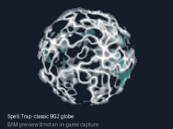

# Arcane Visions

**Spell effect animations for BGEE, BG2EE and EET.**

Give selected original spells new visual effects from **Spell Revisions** and
**Icewind Dale: Enhanced Edition**, plus an optional **classic BG2 Spell Trap
globe** from Cowled Menace. Spell mechanics and icons stay unchanged.
**No Spell Revisions, IWDification or Cowled Menace installation is required.**

**v0.2.0-beta.14** · by **Sauler89** ·
[Full spell list](sr_original_spell_animations/docs/SPELL_LIST.md) · [Changelog](CHANGELOG.md)

## Animation previews

Click any animation to view it at full size. These GIFs show the included BAM
artwork with approximate blending; they are not in-game captures.

<table>
<tr>
<td align="center" width="25%"><b>Protection aura · SPMAGGLO</b><br><a href="docs/previews/spmagglo.gif"></a></td>
<td align="center" width="25%"><b>Ghost Armor</b><br><a href="docs/previews/ghost-armor.gif"></a></td>
<td align="center" width="25%"><b>Mantle</b><br><a href="docs/previews/mantle.gif"></a></td>
<td align="center" width="25%"><b>Spell Trap · classic BG2</b><br><a href="docs/previews/spell-trap.gif"></a></td>
</tr>
<tr>
<td align="center" width="25%"><b>Entangle</b><br><a href="docs/previews/entangle.gif"></a></td>
<td align="center" width="25%"><b>Chromatic Orb</b><br><a href="docs/previews/chromatic-orb.gif"></a></td>
<td align="center" width="25%"><b>Blade Barrier</b><br><a href="docs/previews/blade-barrier.gif"></a></td>
<td align="center" width="25%"><b>Sanctuary</b><br><a href="docs/previews/sanctuary.gif"></a></td>
</tr>
<tr>
<td align="center" width="25%"><b>Protection from Arrows</b><br><a href="docs/previews/protection-from-arrows.gif"></a></td>
<td align="center" width="25%"><b>Minor Globe of Invulnerability</b><br><a href="docs/previews/minor-globe.gif"></a></td>
<td align="center" width="25%"><b>Globe of Invulnerability</b><br><a href="docs/previews/globe-of-invulnerability.gif"></a></td>
<td align="center" width="25%"><b>Otiluke’s Resilient Sphere</b><br><a href="docs/previews/resilient-sphere.gif"></a></td>
</tr>
<tr>
<td align="center" width="25%"><b>Glitterdust</b><br><a href="docs/previews/glitterdust.gif"></a></td>
<td align="center" width="25%"><b>Resurrection</b><br><a href="docs/previews/resurrection.gif"></a></td>
<td align="center" width="25%"><b>Sol’s Searing Orb · travel</b><br><a href="docs/previews/sols-searing-orb-travel.gif"></a></td>
<td align="center" width="25%"><b>Call Lightning</b><br><a href="docs/previews/call-lightning.gif"></a></td>
</tr>
<tr>
<td align="center" width="25%"><b>Conjure Fire Elemental</b><br><a href="docs/previews/conjure-fire-elemental.gif"></a></td>
<td align="center" width="25%"><b>Conjure Air Elemental</b><br><a href="docs/previews/conjure-air-elemental.gif"></a></td>
<td align="center" width="25%"><b>Conjure Earth Elemental</b><br><a href="docs/previews/conjure-earth-elemental.gif"></a></td>
<td></td>
</tr>
</table>

## Components

Install any combination of these optional components:

| Component | Content |
|---|---|
| **0 — Spell Revisions** | Selected spell effects, elemental arrival animations and the shared protection aura. |
| **10 — IWDEE** | Selected spell effects, both invulnerability globes, Sanctuary, Sol's Searing Orb and Call Lightning. |
| **20 — Classic Spell Trap** | The original-style BG2 globe, applied only to the level 9 wizard spell (`SPWI902`). |

[See every affected spell and BAM assignment](sr_original_spell_animations/docs/SPELL_LIST.md).
Web, Abi-Dalzim's Horrid Wilting, Dimension Door and Shadow Door keep their installed graphics.

## Installation

1. Extract the package into the game folder containing `chitin.key`.
2. Run **`setup-sr_original_spell_animations.exe`** and select the components you want. The installer is English only.
3. Install after mods that change these spells; on EET, install after **EET_end**.

Use the same installer to reinstall or uninstall. BGEE with or without SoD,
BG2EE and EET are supported. On Linux/macOS, use a native WeiDU executable:

```sh
weidu sr_original_spell_animations/setup-sr_original_spell_animations.tp2
```

## Compatibility

- Only existing spells are patched; no new spells or gameplay changes are added. Missing or unsupported resources are skipped.
- **Shared graphics:** the Entangle, Chromatic Orb, `SPMAGGLO` and `SKYBOLT` replacements also affect other spells/items using those graphics.
- **Spell Trap:** while active, component 20 also hides other hardcoded protection auras on the same character. Their mechanics are unaffected. [Details](sr_original_spell_animations/docs/SPELL_TRAP.md).
- **Beta:** installer/data checks have passed; visual behavior still needs confirmation in a running game.

## Credits and details

Spell Revisions: **Demivrgvs, Mike1072, Ardanis, Yarpen and Scorpio**.
IWDEE/BG artwork: **Black Isle Studios, Interplay, BioWare and Beamdog**.
Cowled Menace: **Maltodaxtrin/Daxtreme**, [CC BY-NC 4.0](sr_original_spell_animations/docs/COWLED-MENACE-LICENSE.md).
Original asset ownership and source terms remain applicable; **SR's source
notice requires its author's consent for redistribution**.

[Full credits and terms](CREDITS.md) ·
[Source audit](sr_original_spell_animations/docs/FULL_SOURCE_AUDIT.md) ·
[Validation](sr_original_spell_animations/docs/RIGOROUS_AUDIT.md) ·
[Ghost Armor fix](sr_original_spell_animations/docs/GHOST_ARMOR_FIX.md)
